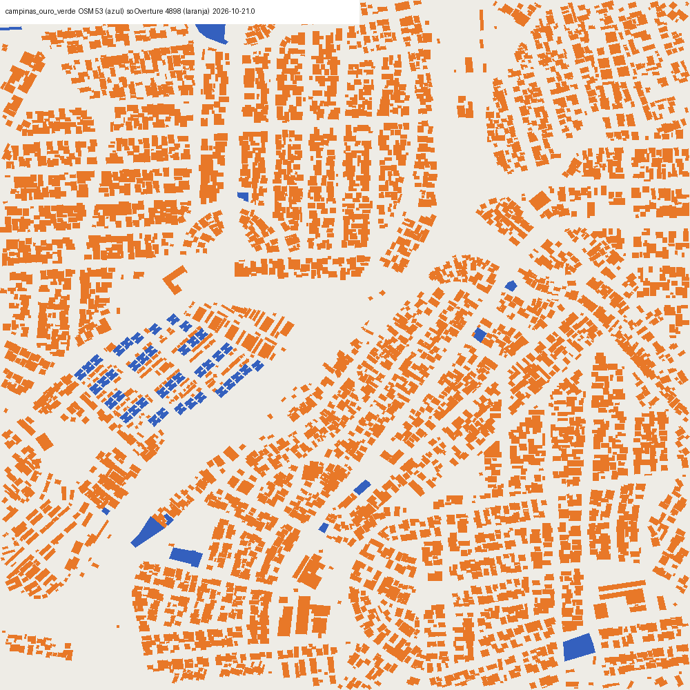

# Medição do Overture Maps (0.22.2)

Pergunta: quanto o Overture Maps acrescenta aos prédios e POIs do OSM que o Kenoma já usa? Medição no pipeline
(`pipeline/measure_overture.py`, DuckDB direto sobre os Parquet públicos no S3). O dono decidiu pôr o Overture nos pacotes
de Campinas e de São Paulo na época 12; o que entrou e o impacto estão no fim, em "Nos pacotes (0.23.0)".

- **Release:** `2026-10-21.0` (a mais recente em 2026-11-17), temas `buildings` (tipo `building`) e `places` (tipo `place`).
- **OSM de comparação:** os nossos arquivos de prédios (`campinas_e0_bldg.bin`, `sao_paulo_e0_bldg.bin`, do extrato da
  Geofabrik de 2026-09-28, MD5 `d4778499…`) e os POIs do mesmo extrato, com as regras do `build_traffic.py` mais
  `amenity=place_of_worship`.
- **"Só no Overture":** prédio do Overture sem nenhuma fonte `OpenStreetMap` (o Overture junta OSM, Microsoft e Google
  Open Buildings e Esri; o que veio do OSM já está nos nossos arquivos).
- **Recortes:** quadrados de ~1,3 km (±0,0062° em volta do centro): o Centro de Campinas (-22.9056, -47.0608), o Ouro Verde
  (-22.9733, -47.1368, bairro periférico) e o entorno da Avenida Paulista (-23.5614, -46.6559).
- Dados brutos: `docs/overture/medicao.json`. Imagens: o OSM em azul, o que só o Overture tem em laranja.

## Prédios

| Recorte | OSM | Overture | Overture vindo do OSM | **Só no Overture** | Com altura ou andares: OSM / Overture / só Overture | Com tipo ou classe: OSM / Overture |
| --- | --- | --- | --- | --- | --- | --- |
| Centro de Campinas | 295 | 3.329 | 283 | **3.046** (10,3 vezes o OSM) | 219 / 209 / 0 | 21 / 35 |
| Ouro Verde | 53 | 4.950 | 52 | **4.898** (92 vezes) | 0 / 0 / 0 | 3 / 8 |
| Entorno da Paulista | 2.948 | 2.904 | 2.805 | **99** (3%) | 2.864 / 2.727 / 0 | 115 / 223 |

Leitura:

- **Campinas é onde o Overture ganha:** o Centro passa de 295 para ~3.300 prédios e o Ouro Verde de 53 para ~4.950. Quase
  tudo o que entra vem de detecção por imagem de satélite (Microsoft e Google): contorno sem tipo e **sem altura nem andares**
  (nenhum dos prédios só do Overture tem altura nos três recortes). No estilo Completo eles entrariam com a altura do tipo
  `yes` (o bloco de 6 a 10 px), sem variar por andar.
- **Em São Paulo o ganho é pequeno:** o OSM da Paulista já tem quase tudo, com andares em 97% dos prédios.

## POIs

| Recorte | Comércio OSM / Overture | Bares e restaurantes | Igrejas | Escolas | Praças |
| --- | --- | --- | --- | --- | --- |
| Centro de Campinas | 131 / 1.201 | 48 / 379 | 13 / 50 | 15 / 198 | 18 / 70 |
| Ouro Verde | 6 / 56 | 2 / 38 | 4 / 22 | 3 / 18 | 4 / 2 |
| Entorno da Paulista | 272 / 1.475 | 195 / 1.035 | 3 / 32 | 17 / 564 | 42 / 69 |

Overture: o grupo pela categoria (`taxonomy.hierarchy[1]` `shopping` = comércio, `food_and_drink` = bares e restaurantes,
`education` = escolas; `basic_category` com `place_of_worship` = igrejas; com `park`, `plaza` ou `square` = praças). O total
de places do Overture nos recortes é 4.655 (Centro), 280 (Ouro Verde) e 13.308 (Paulista). Os POIs do Overture têm
`confidence` e muitos vêm de fontes comerciais (Meta, Foursquare): uma época que os use precisaria de um corte por confiança.

## Tamanho, se entrasse nos pacotes

Os prédios só do Overture nas regiões inteiras (a bbox de `pipeline/regions.json`), no tamanho médio de um prédio no
formato `BLD2` (~13 bytes):

| Região | Prédios só do Overture | A mais no arquivo de prédios | Hoje |
| --- | --- | --- | --- |
| Campinas | 901.480 | ~11,7 MB (no APK) | 0,45 MB |
| São Paulo | 2.726.835 | ~35,9 MB (baixado) | 28,4 MB |

Com o formato por tile da 0.22.2 o app só carrega os tiles em volta da câmera, então o custo é de download e de disco, não
de memória (o teto de 24 MB continua valendo). Os POIs não pesariam nos pacotes de prédios: entrariam no arquivo de pontos
(`_traffic.bin`), de uns 4 bytes por ponto.

## Licenças

| Tema | Licença | O que pede |
| --- | --- | --- |
| `buildings` | **ODbL 1.0** (a mesma do OSM) | atribuição ("© OpenStreetMap contributors, Overture Maps Foundation" e as fontes) e manter derivados abertos sob ODbL |
| `places` | **CDLA Permissive 2.0** | atribuição; uso livre, inclusive comercial |

## Como rodar de novo

`cd pipeline && .venv/bin/python measure_overture.py` (uns 9 minutos: a consulta ao S3 e a leitura do extrato para os POIs
do OSM). Troque `RELEASE` no topo do script para outra release. Precisa de `duckdb` e `pillow` no `.venv`
(`requirements.txt`).

## Nos pacotes (0.23.0, época 12)

Mesma release (`2026-10-21.0`), fixada em `pipeline/fetch_overture.py` e registrada na época 12 (`overture_release`). Regras
em `pipeline/overture.py`, testes em `pipeline/test_overture.py`, comandos e SHAs em `pipeline/README.md`.

- **Prédios:** entram só os contornos do Overture sem fonte OpenStreetMap, fora os subterrâneos, e só se não cobrirem mais de
  30% da área de um prédio do OSM (ou de um do Overture já aceito). Em Campinas, 901.887 contornos sem fonte OSM; 856 cobriam
  um prédio do nosso extrato (o OSM do Overture é de outra data) e ficaram de fora; entraram **901.031**. Nenhum tinha classe
  que alguma regra de bioma use, nem altura ou andares: todos entram com a altura estimada pelo tamanho e pelo tipo.
- **Places:** confiança mínima 0,7 e fora os fechados. Nos 94.561 places da bbox de Campinas, ficam 65.703 com 0,5, **45.525
  com 0,7** e 23.418 com 0,9. O campo `operating_status` existe, mas só 25 places têm valor (todos `open`): nenhum caiu por
  fechado. Dos 45.525, 19.368 têm uma categoria que o jogo usa; 1.208 casaram com um POI do OSM (mesmo grupo, nome parecido, a
  até 30 m) e ficaram de fora; entraram **18.160**: comércio 10.358, bar ou restaurante 4.299, igreja ou templo 1.681, escola
  1.140, praça 310, hospital 298, estádio 56, rodoviária 18.
- **Categorias:** pela taxonomia do Overture, elemento a elemento: comércio é `shopping` (com padarias e doces, que no OSM são
  `shop=*`); bar ou restaurante é o resto de `food_and_drink`; escola é `place_of_learning` fora os cursos
  (`specialty_school`: autoescola, idiomas, música); praça é `park` (fora parque aquático e nacional) e `public_plaza`;
  estádio é `stadium_arena`; igreja e templo é `place_of_worship` (`religious_organization`, que inclui escritórios, fica de
  fora). As candidatas a dungeon do GDD (praças, parques, mirantes) são as praças do arquivo de pontos (tipo 9).

### Impacto em Campinas (sem e com o Overture)

| | Sem Overture | Com Overture |
| --- | --- | --- |
| Pacote de biomas | `campinas_e11.bin`, 439.957 bytes | `campinas_e12_ov.bin`, 441.646 bytes (+0,4%) |
| Arquivo de pontos | `campinas_e12_traffic.bin`, 66.823 bytes | `campinas_e12_ov_traffic.bin`, 128.979 bytes (+93%) |
| Prédios (cenário, no APK) | `campinas_e0_bldg.bin`, 448.088 bytes, 32.116 prédios | `campinas_e12_ov_bldg.bin`, 9.366.856 bytes (21 vezes), 933.147 prédios |

- **Biomas:** mudam **6 das 87.300 células z18** (0,007%; 0,016% das que não são Vazio): 3 de Vazio para Iluminado, 1 de Vazio
  para Sagrado, 1 de Residencial para Verde e 1 de Iluminado para Urbano. Em z21 mudam 0,022% das células. O bioma da z18 é a
  moda das 8 × 8 células z21, empate pela maior prioridade (`pipeline/overture_impact.py`). Quem muda o bioma são os 1.269
  places sem par no OSM que caem dentro de um prédio e valem como a tag do OSM na área dele (shopping, supermercado, feira,
  igreja, escola, hospital, rodoviária); o comércio comum não vira Iluminado, como no OSM. A participação de cada bioma na
  grade fica igual na primeira casa decimal (Iluminado 2,0%, Sagrado 0,1%). Bem abaixo do limite de 30%.
- **Pontos de spawn por condição** (o arquivo de pontos que a camada pessoal lê):

| Condição | Tipos | Pontos sem / com | Células z20 com âncora sem / com |
| --- | --- | --- | --- |
| Becos e marquises (Shade) | comércio, bar, beco | 6.407 / 22.315 (comércio 2.536 → 12.737, bar 1.026 → 5.280, beco 2.845 → 4.298) | **4.456 → 15.784** (+11.328, nenhuma perdida) |
| Postes (Hum) | semáforo, ponto de ônibus | 2.167 / 2.167 | 1.856 → 1.856 |
| Escolas, praças, estádios (vida urbana) | 8, 9, 10 | 2.166 / 3.668 | só cenário |

  Os becos crescem porque os prédios do Overture fecham mais caminhos de pedestre "entre construções". O Overture não traz
  semáforo nem ponto de ônibus: os postes não mudam.

### Impacto em São Paulo

| | Sem Overture | Com Overture |
| --- | --- | --- |
| Pacote de biomas | `sao_paulo_e12.bin`, 862.387 bytes | `sao_paulo_e12_ov.bin`, 873.510 bytes (+1,3%) |
| Arquivo de pontos | `sao_paulo_e12_traffic.bin`, 674.764 bytes | `sao_paulo_e12_ov_traffic.bin`, 1.096.958 bytes (+63%) |
| Prédios (baixado) | `sao_paulo_e0_bldg.bin`, 28.366.947 bytes, 2.199.471 prédios | `sao_paulo_e12_ov_bldg.bin`, 54.239.483 bytes (1,9 vez), 4.925.644 prédios |

- **Prédios:** 2.727.720 contornos sem fonte OSM; 1.547 cobriam um prédio do OSM; entraram 2.726.173. 2.602 tiles, o maior com
  100.851 bytes (o limite do app é 512 KB). O download da região inteira (biomas, visual, caminhos, rota, pontos e prédios) vai de uns 42 MB para uns 68 MB.
- **Places:** dos 676.179, ficam 446.298 com 0,5, **303.566 com 0,7** e 150.201 com 0,9; 6 marcados como fechados. 7.459
  casaram com o OSM; entraram 122.287 (comércio 65.240, bar 31.206, igreja 12.535, escola 9.173, hospital 1.921, praça 1.739,
  estádio 316, rodoviária 157).
- **Biomas:** mudam **108 das 179.208 células z18** (0,06%; 0,12% das que não são Vazio), quase todas de Vazio ou Urbano para
  Urbano, Iluminado ou Sagrado (os places dentro de prédios). Em z21, 0,10%.
- **Becos e marquises (Shade):** células z20 com âncora de 46.313 para 116.154 (comércio 16.604 → 81.134, bar 6.583 → 37.532,
  beco 51.184 → 67.064). **Postes (Hum):** 29.362, sem mudança.
