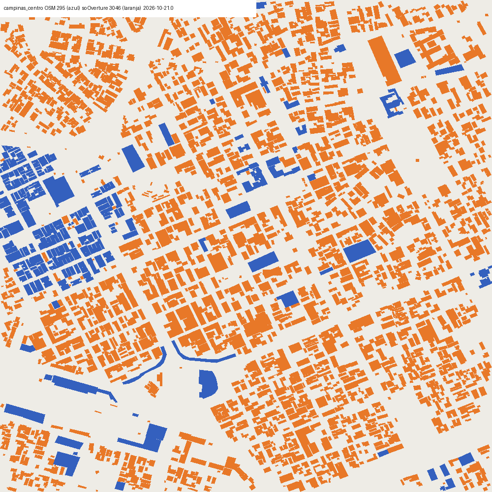
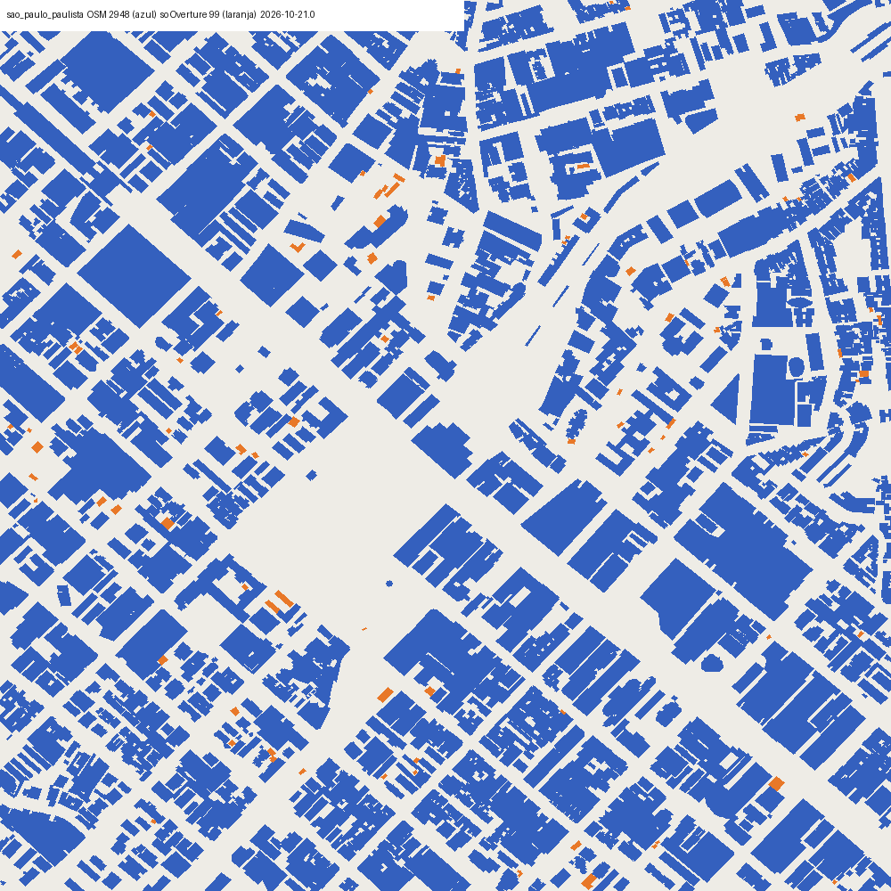

# Medição do Overture Maps (0.22.2)

Pergunta: quanto o Overture Maps acrescenta aos prédios e POIs do OSM que o Kenoma já usa? Só medição no pipeline
(`pipeline/measure_overture.py`, DuckDB direto sobre os Parquet públicos no S3). **Nada disto foi para o app nem para os
pacotes.** A decisão de pôr o Overture numa época é do dono, com este documento.

- **Release:** `2026-10-21.0` (a mais recente em 2026-11-17), temas `buildings` (tipo `building`) e `places` (tipo `place`).
- **OSM de comparação:** os nossos arquivos de prédios (`campinas_e0_bldg.bin`, `sao_paulo_e0_bldg.bin`, do extrato da
  Geofabrik de 2026-09-28, MD5 `d4778499…`) e os POIs do mesmo extrato, com as regras do `build_traffic.py` mais
  `amenity=place_of_worship`.
- **"Só no Overture":** prédio do Overture sem nenhuma fonte `OpenStreetMap` (o Overture junta OSM, Microsoft e Google
  Open Buildings e Esri; o que veio do OSM já está nos nossos arquivos).
- **Recortes:** quadrados de ~1,3 km (±0,0062° em volta do centro): o Centro de Campinas (-22.9056, -47.0608), o Ouro Verde
  (-22.9733, -47.1368, bairro periférico) e o entorno da Avenida Paulista (-23.5614, -46.6559).
- Dados brutos: `docs/overture/medicao.json`. Imagens: o OSM em azul, o que só o Overture tem em laranja.

## Prédios

| Recorte | OSM | Overture | Overture vindo do OSM | **Só no Overture** | Com altura ou andares: OSM / Overture / só Overture | Com tipo ou classe: OSM / Overture |
| --- | --- | --- | --- | --- | --- | --- |
| Centro de Campinas | 295 | 3.329 | 283 | **3.046** (10,3 vezes o OSM) | 219 / 209 / 0 | 21 / 35 |
| Ouro Verde | 53 | 4.950 | 52 | **4.898** (92 vezes) | 0 / 0 / 0 | 3 / 8 |
| Entorno da Paulista | 2.948 | 2.904 | 2.805 | **99** (3%) | 2.864 / 2.727 / 0 | 115 / 223 |

Leitura:

- **Campinas é onde o Overture ganha:** o Centro passa de 295 para ~3.300 prédios e o Ouro Verde de 53 para ~4.950. Quase
  tudo o que entra vem de detecção por imagem de satélite (Microsoft e Google): contorno sem tipo e **sem altura nem andares**
  (nenhum dos prédios só do Overture tem altura nos três recortes). No estilo Completo eles entrariam com a altura do tipo
  `yes` (o bloco de 6 a 10 px), sem variar por andar.
- **Em São Paulo o ganho é pequeno:** o OSM da Paulista já tem quase tudo, com andares em 97% dos prédios.

## POIs

| Recorte | Comércio OSM / Overture | Bares e restaurantes | Igrejas | Escolas | Praças |
| --- | --- | --- | --- | --- | --- |
| Centro de Campinas | 131 / 1.201 | 48 / 379 | 13 / 50 | 15 / 198 | 18 / 70 |
| Ouro Verde | 6 / 56 | 2 / 38 | 4 / 22 | 3 / 18 | 4 / 2 |
| Entorno da Paulista | 272 / 1.475 | 195 / 1.035 | 3 / 32 | 17 / 564 | 42 / 69 |

Overture: o grupo pela categoria (`taxonomy.hierarchy[1]` `shopping` = comércio, `food_and_drink` = bares e restaurantes,
`education` = escolas; `basic_category` com `place_of_worship` = igrejas; com `park`, `plaza` ou `square` = praças). O total
de places do Overture nos recortes é 4.655 (Centro), 280 (Ouro Verde) e 13.308 (Paulista). Os POIs do Overture têm
`confidence` e muitos vêm de fontes comerciais (Meta, Foursquare): uma época que os use precisaria de um corte por confiança.

## Tamanho, se entrasse nos pacotes

Os prédios só do Overture nas regiões inteiras (a bbox de `pipeline/regions.json`), no tamanho médio de um prédio no
formato `BLD2` (~13 bytes):

| Região | Prédios só do Overture | A mais no arquivo de prédios | Hoje |
| --- | --- | --- | --- |
| Campinas | 901.480 | ~11,7 MB (no APK) | 0,45 MB |
| São Paulo | 2.726.835 | ~35,9 MB (baixado) | 28,4 MB |

Com o formato por tile da 0.22.2 o app só carrega os tiles em volta da câmera, então o custo é de download e de disco, não
de memória (o teto de 24 MB continua valendo). Os POIs não pesariam nos pacotes de prédios: entrariam no arquivo de pontos
(`_traffic.bin`), de uns 4 bytes por ponto.

## Licenças

| Tema | Licença | O que pede |
| --- | --- | --- |
| `buildings` | **ODbL 1.0** (a mesma do OSM) | atribuição ("© OpenStreetMap contributors, Overture Maps Foundation" e as fontes) e manter derivados abertos sob ODbL |
| `places` | **CDLA Permissive 2.0** | atribuição; uso livre, inclusive comercial |

## Como rodar de novo

`cd pipeline && .venv/bin/python measure_overture.py` (uns 9 minutos: a consulta ao S3 e a leitura do extrato para os POIs
do OSM). Troque `RELEASE` no topo do script para outra release. Precisa de `duckdb` e `pillow` no `.venv`
(`requirements.txt`).
